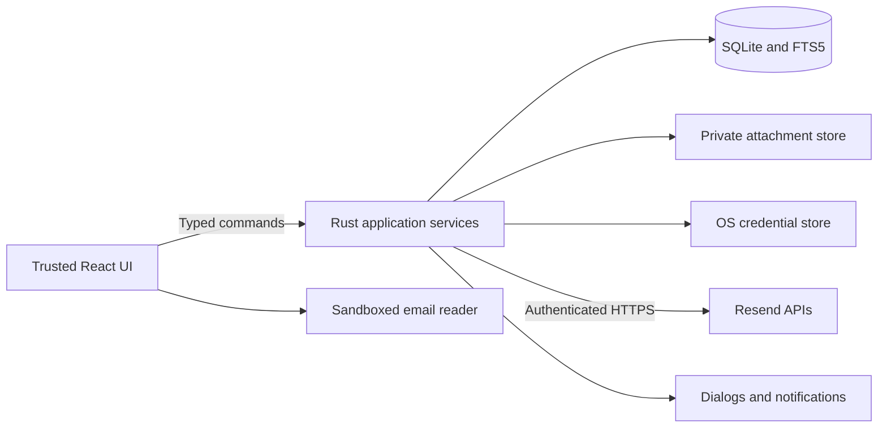
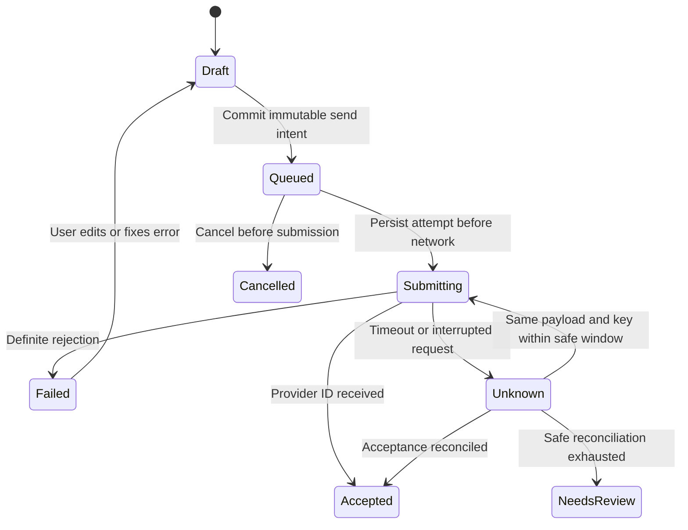

# Desktop architecture and data design

Status: proposed · 2026-10-14

## Boundaries

The trusted UI manages interaction and transient view state. Rust owns connection credentials, provider access, synchronization, sending, database transactions, file operations, and native integrations. The mail reader receives a sanitized presentation document and has no privileged commands, credentials, application origin access, or arbitrary network access.

Use domain services behind interfaces: `MailProvider`, `MailRepository`, `SecretStore`, `AttachmentStore`, and `Notifier`. Proposed frontend commands include `list_messages`, `read_message`, `save_draft`, `enqueue_send`, `set_local_flags`, `refresh_connection`, `save_attachment`, and `export_profile`. Commands validate profile ownership and bounded arguments. Never expose general SQL, unrestricted paths, arbitrary HTTP, or shell commands.

## Local data model

| Entity | Essential fields and invariants |
| --- | --- |
| Connection/profile | Local UUID, provider/team scope when known, credential reference, capability results, sync configuration. A rotated key must not silently switch team identity. |
| Identity | Connection ID, exact email address, display name, signature, default flag, validation state. |
| Message | Local ID, connection ID, provider namespace/direction, provider ID, RFC message ID, timestamps, addresses, subject, headers, bodies, content fetch state, local thread ID. Unique `(connection, namespace, provider_id)`. |
| Message flags | Message ID, read/starred, local folder, revision. Sync never overwrites local state with missing provider fields. |
| Thread | Local ID, connection ID, anchor message ID, derived subject/participants and activity. Recomputed references may merge local groups. |
| Label and membership | Profile-scoped label ID/name/color and message membership. |
| Draft | UUID, revision, identity, recipients, editor document, generated HTML/text, reply context, attachment references, committed timestamp. |
| Send intent | UUID, immutable payload snapshot/hash, idempotency key, first-submission timestamp, state, provider ID if known, retry schedule, redacted error. |
| Attachment | Message/draft ID, provider attachment ID, safe display name, MIME type, size, CID, content hash, relative local path, download state. |
| Sync state | Connection, direction, import cursor, latest scan coverage, last completed refresh, pending hydration jobs. |
| Tombstone | Provider identity plus local removal timestamp; persists through future imports. |

Keep provider resource IDs and RFC Message-ID values separate. Two provider records with the same RFC ID may still represent different send/receive records; do not silently discard one. Avoid lowercasing RFC message IDs. Normalize addresses for matching cautiously, preserving original display values and local parts; do not infer that plus addresses or all local-part casing are universally interchangeable.

Use SQLite transactions, foreign keys, unique constraints, WAL where supported, versioned migrations, and bounded background indexing. FTS indexes downloaded subject/text/participants only. All database access goes through Rust; one writer queue serializes mutations. Attachment bytes live under generated private paths, with hashes and references in SQLite; user-supplied filenames never determine internal storage paths.

The baseline is plain SQLite, not an encrypted database. Protect per-user files using platform permissions and recommend OS disk encryption in storage settings. Application-level encryption is a separate decision covering DB, indexes, attachments, keys, exports, and recovery; adding it only to body fields would leave sensitive metadata exposed.

## Incoming and outgoing synchronization

1. Bootstrap with a newest-record scan per direction and show recent metadata promptly. Continue older history using durable cursors and a bounded job queue.
2. Commit each page's upserts, hydration jobs, and next cursor in one transaction. Restarting a page is safe because provider identities are unique. Never advance coverage before the data commits.
3. Fetch new metadata periodically: proposed 30 seconds in foreground, 120 seconds in enabled background mode, with jitter. Suspend when offline and refresh on resume. These are tunable defaults, not provider guarantees.
4. Restart each new-mail scan from the documented newest end, overlap previously seen coverage, and paginate until reaching a validated boundary. During initial backfill, continue independent newest scans so new arrivals cannot be stranded behind old pages.
5. Do not stop at the first duplicate until ordering behavior is verified. With no guaranteed snapshot/change token, run periodic bounded reconciliation and allow full rescan. Invalid cursors trigger a safe rescan using idempotent upserts.
6. Hydrate selected bodies immediately and other bodies in background. Track queued/downloading/complete/unavailable/failed states, size limits, and retries. Keep attachment bytes on demand unless the user requests offline retention.
7. Notify only for newly discovered incoming records after initial coverage, once per local message. Use the last successful refresh marker and persist notification deduplication; preserve a sensible summary after long downtime.

Do not interpret absent provider records as local deletions. Remote expiration or inaccessible history must not erase saved correspondence. Preserve local flags and tombstones across all scans. Last successful synchronization means a completed scan, not a request started. Show partial progress independently.

Use one connection-level request scheduler with low initial concurrency, budgets for user actions, and adaptive rate limits. Honor server backoff, apply exponential delay and jitter for transient failures, pause on authorization errors, and distinguish quotas from short rate-limit windows. Multiple clients sharing a team still compete for the provider's limit; local scheduling cannot globally coordinate them.

Outgoing delivery information is refreshed for recent pending records with increasing intervals and a bounded horizon. Unknown provider status values stay unknown; no-data responses do not mean delivered. Import outside-client sent records under the same provider-ID uniqueness rules.

## Sending and recovery

Enqueueing snapshots the current draft and attachment bytes in a durable transaction; double-click Send creates one intent for that revision. The worker persists Submitting and the first-attempt timestamp before HTTP. On success, persist the provider ID, accepted message, and completed intent atomically; retire the associated draft only after that commit.

Retry the exact immutable payload with the same key within the documented provider window, measured conservatively from the earliest possible submission with a safety margin. Never mutate a submitted payload under that key. A restart treats unresolved Submitting intents as Unknown. Reconcile known provider IDs first; correlation metadata may help discovery but is not proof based only on recipient/subject/time.

When the idempotency window has expired, timing is uncertain, or acceptance cannot be established, pause for explicit review. A user-requested resend creates a new intent and states the duplication risk. Editing an unsubmitted item returns it to Draft; submitted unknown items retain their audit record. “Accepted,” “Delivered,” “Bounced,” and “Failed” remain distinct. No send-retry policy can promise exactly-once end-user delivery. See the [provider contract](./resend-feasibility.md) for the current window and limits.

## Conversations and composition

Build conversation graphs per connection using References and In-Reply-To, with RFC Message-ID as the anchor. Link missing parents when they arrive. Detect cycles and bound reference-chain processing. Subject similarity alone is insufficient to merge unrelated mail; show standalone messages when evidence is absent.

Generate a restricted HTML subset and a text alternative from the editor model. Sanitize pasted content, validate header fields against CR/LF injection, and serialize addresses with a tested parser. Reply uses Reply-To or From; Reply All uses visible To/Cc plus the reply target, removes configured own identities, and deduplicates. Forwarding is a new send intent; quoted content cannot introduce active markup or automatically include inaccessible files.

## Email-content security

Follow Tauri's [security model](https://tauri.app/security/) and define capabilities per trusted window. Avoid broad plugin permissions. The reader must not inherit the trusted application's command authority.

Use a sandboxed opaque-origin iframe or separately isolated content view with no scripts, same-origin permission, forms, popups, or top navigation. Apply a restrictive reader CSP independently of the application CSP. Sanitize markup and CSS with an allowlist; remove scripts, event attributes, active SVG, forms, embeds, remote styles, font requests, and CSS URLs. Apply size and nesting limits before rendering. Text-only fallback is required for oversized or unsafe content.

Resolve only known CID/embedded raster images through controlled, bounded local resources. Never enable arbitrary data-URL content types. External images remain blocked; explicit loading fetches only approved HTTPS images through a constrained service without API credentials, rejecting private-network destinations and unsafe redirects. Preserve this boundary even if a sender marks content as trusted.

External links are presented with their actual destination and opened through a validated OS action; block executable/file/application schemes. A sandboxed reader may require an inert link representation and trusted overlay for user activation rather than a script bridge. Prove this interaction in the prototype. Never add reader IPC merely to make links convenient.

Attachment downloads use only provider-issued URLs under an explicit tested policy, validate HTTPS and redirects, stream with byte limits, and write atomically. Do not send the Resend Authorization header to download hosts. Save As requires a native dialog, sanitizes display filenames, handles collisions, and never executes or previews active files automatically.

## Credentials, backup, and diagnostics

Keep API credentials in native secure storage, referenced by opaque IDs. If secure storage is unavailable, stop connection setup with a clear recoverable error; never silently store plaintext. The Rust core may hold credentials only as needed. Logs redact authorization headers, signed URL query strings, recipients, subjects, and bodies by default.

Backup pauses mutations briefly or uses a consistent SQLite snapshot, copies referenced files, and writes a versioned manifest and checksums. Exports exclude credentials and transient download URLs and are explicitly sensitive files. Restore validates paths/checksums/schema before importing to a separate profile. Profile deletion offers export, removes local records/files and secrets deliberately, and explains that provider data is unaffected.

Track operational counters such as sync latency, job backlog, retry category, and local DB errors without message content. Diagnostic export is user-initiated and reviewable. UI errors carry a category, recovery action, and safe correlation ID rather than raw provider request dumps.
